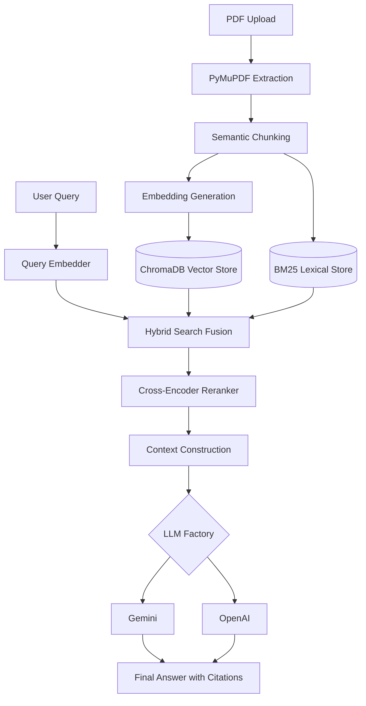

# Hackathon-Grade RAG Documentation Chatbot

## Problem Statement
Users need to ask complex questions across multiple large PDF documents and receive accurate, highly-grounded answers without hallucinations. Traditional vector-search alone often fails at exact keyword matching (like SKUs or specific years) and naive chunking destroys structural context.

## Solution
This project implements a robust Retrieval-Augmented Generation (RAG) pipeline featuring:
- Layout-aware PDF extraction.
- Semantic Chunking.
- Hybrid Retrieval (Dense Vector Search + Sparse BM25 Lexical Search).
- Cross-Encoder Reranking.
- Configurable LLM Providers (Gemini & OpenAI).
- Accurate source citations mapping back to document pages.

## Architecture


## Technology Stack
**Backend**: Python, FastAPI, PyMuPDF, ChromaDB, Rank_BM25, Sentence-Transformers, Google GenAI SDK, OpenAI SDK.
**Frontend**: React, Vite, Vanilla CSS.

## Setup & Running the Application

### 1. Environment Configuration
Navigate to the `backend` directory and edit `.env` (copied from `.env.example`):
```env
LLM_PROVIDER=gemini # or openai
GEMINI_API_KEY=your_gemini_api_key_here
OPENAI_API_KEY=your_openai_api_key_here
```
*Note: If no valid keys are provided, the system seamlessly falls back to a MockProvider to allow testing the retrieval pipeline end-to-end without credentials.*

## Multi-Document Support

The system supports ingestion of multiple documents within a workspace.

Each document maintains independent metadata and indexed content.

Users can query:
- a single document
- selected documents
- all uploaded documents

The existing hybrid retrieval and Cross-Encoder reranking pipeline remains unchanged.

## Multilingual RAG

The system supports cross-lingual document question answering.

Users can ask questions in supported languages (tested in English, Tamil, and Hindi) even when the source documents are written in another language.

Multilingual retrieval uses `BAAI/bge-m3` via dual-indexing, preserving the existing hybrid retrieval, reranking, conversational query rewriting, multi-document support, and citation pipeline.

### 2. Start the Backend
```bash
cd backend
python -m venv venv
source venv/bin/activate
pip install -r requirements.txt
uvicorn app.main:app --host 0.0.0.0 --port 8001
```

### 3. Start the Frontend
```bash
cd frontend
npm install
npm run dev
```

## Testing & Evaluation
An end-to-end test script `e2e_test.py` is included in the `backend/` folder. It programmatically uploads a test PDF, waits for processing, and performs hybrid search + RAG generation.

Run it with:
```bash
cd backend
source venv/bin/activate
python e2e_test.py
```

## Known Issues & Limitations
- The current semantic chunking is a rudimentary paragraph grouper. Using a more advanced NLP library like `spacy` could yield finer sentence-level splits.
- BM25 index is stored in a local JSON file. For a production environment, this should be moved to a robust search engine like Elasticsearch.

## Future Improvements
- Add conversational memory to the retrieval step (query rewriting based on history).
- Improve table extraction using `pdfplumber` or `docling` to convert structured data to markdown tables.
